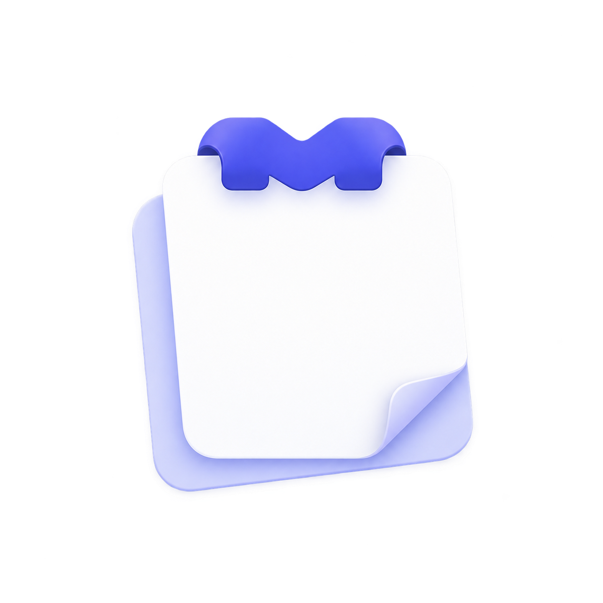
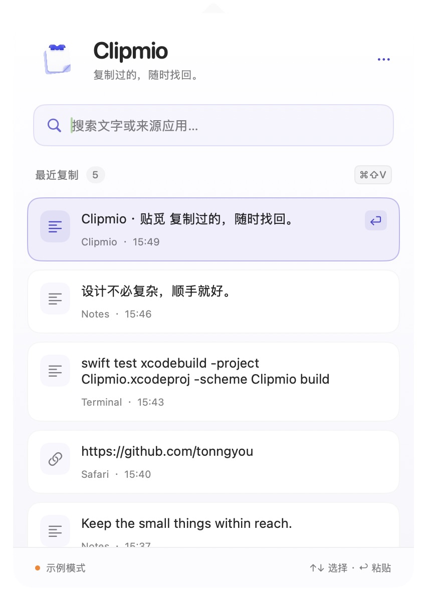
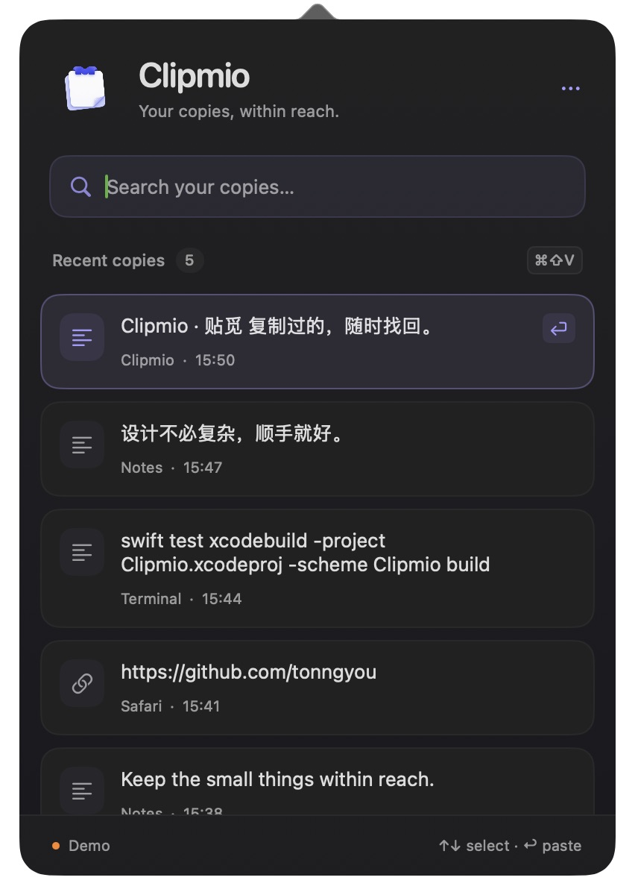
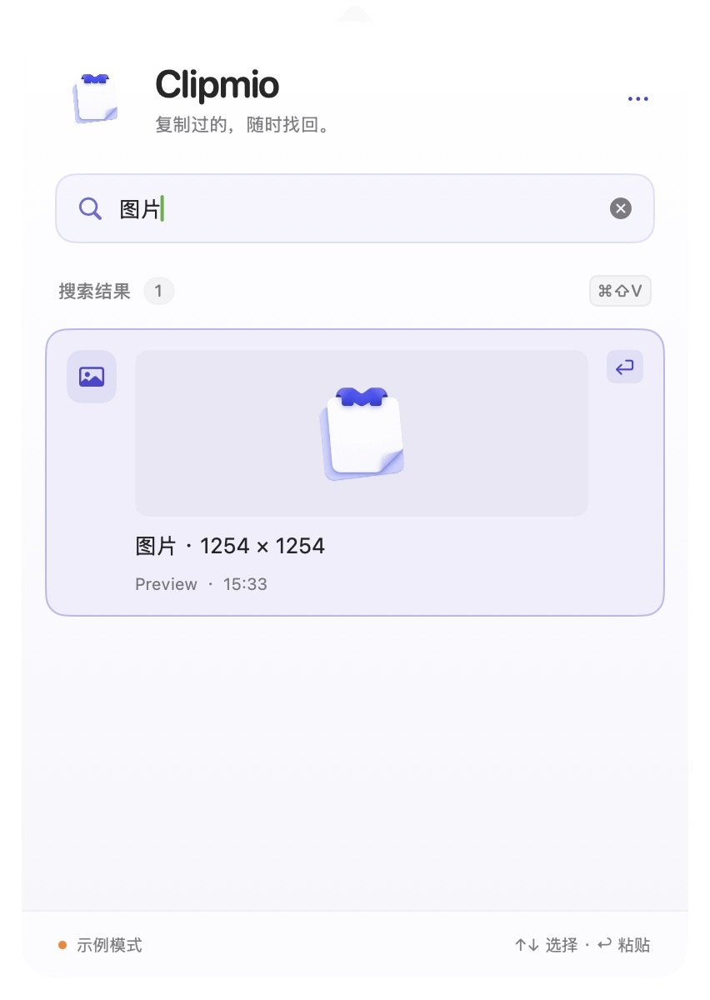
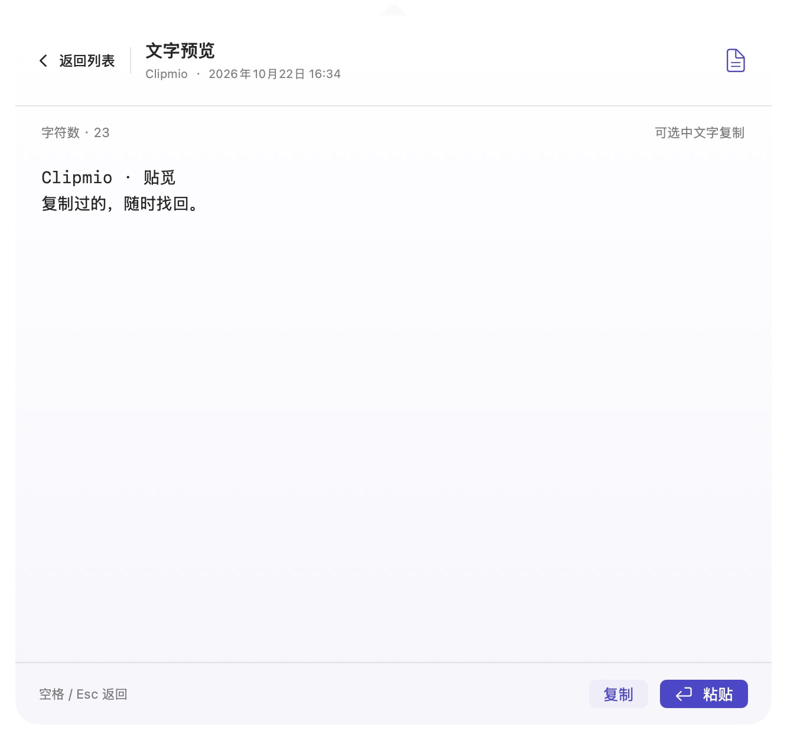
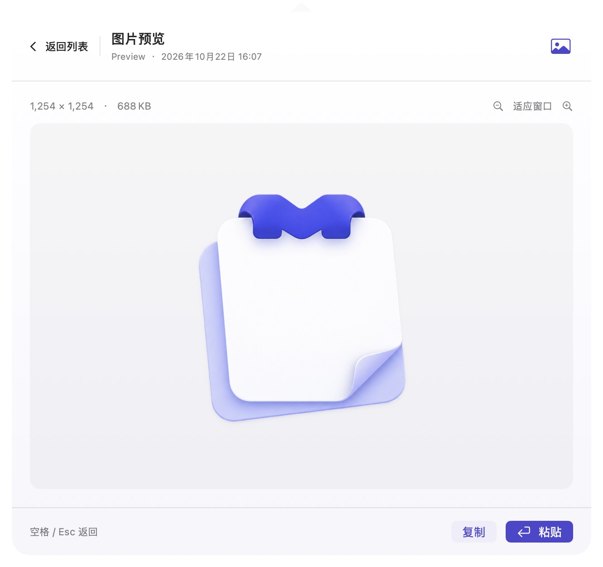

# Clipmio · 贴觅



**复制过的，随时找回。 · Your copies, within reach.**

A small, native clipboard history for macOS 14+. Made by [tonngyou](https://github.com/tonngyou), with a SwiftUI app lifecycle and interface, plus macOS system bridges. No third-party dependencies, account, server, or analytics.

 

## 功能

- 在菜单栏打开轻量列表，记录启动后复制的文字与图片。
- 默认在任何应用中按 `⌘⇧V` 打开历史，再按一次收起；可在设置中录入自定义组合键。每次打开都会清空搜索词并聚焦搜索框。
- 保存最近 50 条，另可收藏 50 条文字或图片；收藏不参与最近记录淘汰。相同内容再次复制会保留收藏状态并移到最前面。
- 默认紧凑布局，卡片左侧显示来源应用图标；设置中可关闭紧凑布局。点星标收藏，点列表上方“收藏”筛选。
- 全部／收藏切换保留滑动选中背景，列表与详情使用轻量进入动画；跟随系统“减少动态效果”改为短淡化。
- 鼠标停在历史列表区域时，可按住鼠标左右拖动，或用触控板左右滑动、鼠标横向滚动、前进／后退侧键切换栏目。普通滚轮可配合 Shift 横向操作；上下滚动不受影响，首尾栏目不循环。
- 图片显示缩略图、像素尺寸和来源；相同 PNG 数据再次复制会移到最前面。
- 搜索文字或来源应用；用 `↑/↓` 选择记录，选中项会高亮并自动滚动到可见区域。
- 搜索框为空时用 `←/→` 切换全部／收藏，首尾不循环。已有搜索文字时，先用 `↑/↓` 进入浏览，再用 `←/→` 切换并保留查询；纯编辑搜索或输入法选词时仍保留左右光标操作。
- 按空格展开所选记录：完整文字可滚动、选取复制，图片可放大查看。再按空格或 `Esc` 返回列表。
- 按回车或点击记录：复制原始文字、返回之前的应用并自动粘贴。
- 按 `Esc` 先清空搜索，再按一次关闭面板；右键“复制”可只复制、不自动粘贴。
- 右键删除单条、收藏；更多菜单中暂停记录、清空最近记录或退出。清空最近记录保留收藏；收藏可右键单独删除。
- 文字与索引保存为本地 JSON，图片单独保存为 PNG；支持跟随系统或手动切换简体中文、繁體中文和英文。
- 过滤声明为 concealed、transient、auto-generated 的内容及部分已知密码管理器来源。这不能识别所有敏感内容。

当前支持纯文本与静态图片。支持在设置中选择开机自启动；没有同步或自动更新。剪贴板按 0.5 秒间隔轮询，极短时间内连续复制的中间内容可能无法捕获。单条文字上限 256 KiB。

旧历史没有应用标识时，会尝试按名称匹配本机应用图标；应用未安装或无法匹配时使用内容类型图标。新记录保存来源应用标识，图标从本机读取。

## 图片的使用方式

将截图复制到剪贴板、在浏览器中选择“复制图像”，或在 Finder 中复制单张 PNG、JPEG、TIFF、HEIC 图片文件。按 `⌘⇧V` 查看缩略图，用方向键选择后回车粘贴；也可以右键“复制”，再自行粘贴到支持图片的应用。

点击图片或按回车确认后，复制成功就会自动收起面板并返回之前的应用；即使未开启自动粘贴权限，也可以直接手动 `⌘V`。如果需要授权或粘贴失败，提示会在下次主动打开历史时显示。只用方向键浏览图片时，面板保持打开。

图片与文字共用最近 50 条的容量，收藏另有 50 条容量。可搜索“图片”“image”或来源应用名称；当前不识别图片中的文字。图片会保存为无损 PNG；原文件被移动或删除后，历史中的副本仍可使用。写回剪贴板时同时提供 PNG 和系统常用的 TIFF 格式。

单张保存后的 PNG 上限 10 MiB，最大 3200 万像素、单边 16384 像素；输入图片数据上限 64 MiB，超出限制或无法解码的图片不会记录。暂不支持动画、多文件复制、普通文件历史或只含图片网址的网页链接。直接复制一张 JPEG 文件与复制其网址是不同的操作。



全局快捷键通过系统热键注册实现，无需辅助功能或输入监控权限。若 `⌘⇧V` 被 Pesty、另一个 Clipmio 实例等应用占用，仍可点击菜单栏图标打开面板；可在设置中录入其他快捷键，或退出占用者后，从更多菜单选择“重试注册快捷键”。

## 空格预览

打开历史后，用 `↑/↓` 选中记录，按空格展开详情。文字会保留原始换行和空格，并支持滚动、选中文字复制；图片显示大图、尺寸和大小，可用放大、缩小、适应窗口查看细节。预览本身不会改动系统剪贴板，也不需要辅助功能权限。

再按空格、`Esc` 或“返回列表”回到原来的搜索和选中位置。预览底部的“复制”“粘贴”和回车使用现有操作；图片粘贴后依然自动收起。

搜索框为空时，空格可直接预览当前高亮项；搜索输入中仍可输入正常的空格，先按方向键选择后再用空格预览。输入法正在组词时，空格交给输入法处理。也可以点列表上方的眼睛按钮或右键“预览”。

 

## 自动粘贴与授权

第一次使用回车或点击粘贴时，如果没有辅助功能权限，文字会复制并在面板显示提示；图片会复制、收起面板，在下次打开历史时显示提示。点击“开启自动粘贴”，在 **系统设置 → 隐私与安全性 → 辅助功能** 中允许当前运行的 Clipmio，然后从目标应用重新呼出历史并选择记录。

权限由你手动开启；仅记录历史、搜索、快捷键和右键复制都不需要这个权限。开发版、Release 版和不同签名的构建可能需要分别授权。

自动粘贴等待 Return 和修饰键松开，再关闭面板、恢复原应用焦点，向原进程发送一组 `⌘V`。如果原应用退出、焦点未能稳定、剪贴板已改变或请求被取消，就停止发送。若目标应用拒绝模拟粘贴，可用右键“复制”后手动 `⌘V`。输入法仍在组词时，上下键和回车交给输入法处理。

## 退出、重启与卡死恢复

- 右键点击菜单栏的 Clipmio 图标（或按住 Control 点击），可直接选择“重启 Clipmio…”或“退出 Clipmio”，无需先打开历史面板。
- 面板右上角的“…”菜单也提供重启和退出。正常重启会先停止监听并释放快捷键，启动成功后退出旧实例；启动失败则保留旧实例并恢复服务。
- Dock 中的 Clipmio 图标右键菜单提供 macOS 标准的“退出 / Quit”，以及打开历史和重启入口。系统菜单的文案跟随 macOS 语言。
- 如果整个进程卡死，应用自己的菜单也可能无法响应。打开 macOS“活动监视器”，搜索 Clipmio，选中后点停止按钮并选择“强制退出”，然后从“应用程序”重新打开。历史在每次变动时保存，强制退出不会主动清空历史。

## 布局、快捷键、语言与开机自启动

打开剪贴板面板右上角的 **… → 设置…**：

- **紧凑布局**：默认开启，缩小顶部和卡片留白，文字使用单行摘要、图片使用小缩略图；完整内容仍可空格预览。关闭后使用双行摘要和大图片缩略图。
- **全局快捷键**：点击组合键按钮后直接按包含 `⌘` 或 `⌃` 的组合键，`Esc` 取消。录入期间暂停旧快捷键，完成或离开录入区域后恢复注册。冲突时保留原组合键；提供恢复默认 `⌘⇧V`。设置会在重启后保留。
- **语言**：跟随系统、简体中文、繁體中文、English。切换立即生效，并记住选择；复制内容不做翻译。
- **开机自启动**：默认不自动注册，按需开启。通过 macOS 的登录项服务在用户登录后启动，在 Dock 和菜单栏显示图标，但不自动弹出历史面板。若系统要求批准，点击“打开登录项设置…”完成允许；关闭开关会注销登录项。

登录项状态以 macOS 为准，从系统设置返回后会刷新。请先把应用放入“应用程序”，避免注册后再移动应用。预览模式和直接运行 SwiftPM 可执行文件时不修改登录项；自动测试使用替身服务，不更改本机自启动设置。

## 安装到本机使用

当前源码版本为 **0.2.4**，包含紧凑布局、来源图标、收藏、自定义快捷键及鼠标／键盘栏目切换。下方已发布安装包仍为 **0.1.1**；使用最新功能请按后文说明从源码构建。

直接下载：[0.1.1 Release 与安装包](https://github.com/tonngyou/Clipmio/releases/tag/v0.1.1)。推荐 DMG，支持 Apple 芯片和 Intel，要求 macOS 14+。本预览版尚未经过 Developer ID 签名和 Apple 公证，首次打开可能需要按发布页说明手动确认。

将构建好的 `dist/Clipmio.app` 拖到 **应用程序（Applications）** 文件夹，再双击打开；以后无需启动 Xcode。运行后点击菜单栏的 Clipmio 图标，或按 `⌘⇧V` 查看历史。运行时也会显示 Dock 图标，点击 Dock 图标可再次打开历史。

开启自动粘贴：进入 **系统设置 → 隐私与安全性 → 辅助功能**，添加并允许 `/Applications/Clipmio.app`。这是安装版，可能需要与 Xcode 开发版分别授权。记录、搜索、空格预览和右键复制不需要此权限。

更新时先从 Clipmio 的更多菜单退出旧版本，再用新的 `.app` 替换应用程序中的版本。不要同时运行 Xcode 版与安装版。安装版使用 Release 历史目录，首次打开不会自动导入开发版历史。

如果只有源代码，先按下面的方式构建，或运行 `bash scripts/build.sh` 生成应用。

## 在 Xcode 中运行

1. 打开 **Clipmio.xcodeproj**，选择 **Clipmio → My Mac**。
2. 按 `⌘R`，菜单栏会出现剪贴板图标。无需配置付费开发者账号。
3. 复制文字或图片，点击图标查看历史。

应用使用普通 Dock 应用模式，同时保留菜单栏入口。开发构建用本地临时签名。不要把它当作已经签名、公证的公开发行包。

也可以打开 `Package.swift` 或使用终端：

```bash
swift run Clipmio
swift test
```

## 示例模式

```bash
swift run Clipmio --demo
swift run Clipmio --demo --dark
```

示例模式只使用内存数据，不读取或修改历史文件，也不启动剪贴板监听；选择示例条目仍会复制文字，并在已授权且存在目标应用时尝试自动粘贴。也可在 Xcode 的 Product → Scheme → Edit Scheme → Run → Arguments 中添加 `--demo`。

## 数据位置与隐私

- Debug：`~/Library/Application Support/Clipmio/Development/history.json`
- Release：`~/Library/Application Support/Clipmio/history.json`
- 图片保存在对应历史文件旁的 `Images/` 文件夹；索引只保存图片尺寸、哈希与文件信息。
- 目录权限 `0700`，历史文件与图片权限 `0600`。**文字与图片都是未加密的本地数据**，不会上传。
- 删除图片、清空历史或超出条数上限后，会在成功保存索引后清理对应图片文件。
- 首次启动不导入当前剪贴板，只记录后续变化。暂停期间的复制不会在恢复后补录。
- 历史文件不可读时保留原文件，新内容只留在内存，并在界面显示提示。明确清空历史后才能重置该文件。
- 点击 GitHub 链接会用浏览器打开作者主页；应用没有后台联网功能。

与 Pesty 的应用标识、偏好设置、历史目录完全独立。Debug 与 Release 也使用不同的历史目录。请勿同时运行多个 Clipmio 实例；更换版本前先从菜单退出旧版本。

## 开发结构

```text
Sources/ClipmioCore/           记录模型、捕获规则、本地保存与搜索
Sources/Clipmio/               菜单栏、监听、SwiftUI 列表
Sources/Clipmio/Resources/     中英文界面文案和开源许可
Tests/                        隔离临时目录和测试剪贴板的回归测试
Configuration/Info.plist       应用身份及菜单栏配置
scripts/                      图标生成、构建与打包
```

`Clipmio.xcodeproj` 和 `Package.swift` 使用相同的源文件。核心逻辑独立成 Swift package target 供测试。修改界面后，先 `swift test`，再在 Xcode 运行检查。Xcode 工程没有单独的 XCTest target，自动测试通过 SwiftPM 运行。

## 界面与 Logo

应用入口使用 SwiftUI `App`，列表、搜索容器、卡片、菜单和空状态均由 SwiftUI 构建。`ClipboardView.swift` 提供明暗两套 Xcode Preview，使用内存示例数据。菜单栏弹出与跨应用焦点通过 `NSApplicationDelegateAdaptor` 连接系统；搜索输入保留原生字段编辑器，以支持中文组词和标准编辑快捷键。

Clipmio 标志采用叠纸、卷角和 M 形夹扣，参考了 ClipLite 图标的简洁气质。最终图形由 imagegen 生成并作为透明 PNG 保存，制作说明与完整提示词见 [BRANDING.md](docs/BRANDING.md)。应用图标、界面品牌图和 README 使用同一图形，菜单栏使用对应的单色简化版本。

- `Sources/Clipmio/Resources/ClipmioLogo.png`：界面使用的透明原图。
- `Assets/Clipmio-logo.png`：可直接取用的同一份 Logo。
- `Assets/Clipmio.icns`：已应用的 macOS 图标。
- `ClipmioBrand.swift`：配色、品牌视图和菜单栏图形。

更换原图后运行 `bash scripts/make-icon.sh`，再重新构建应用。

## 打包自用

```bash
bash scripts/build.sh
open dist/Clipmio.app
```

默认生成当前 Mac 架构的 Release 应用。构建同时支持 Apple Silicon 和 Intel 的版本：

```bash
UNIVERSAL=1 bash scripts/build.sh
```

成品在 `dist/Clipmio.app` 和 `dist/Clipmio-0.2.4.zip`。更新版本号时修改 Xcode 工程中的 `MARKETING_VERSION` 和 `CURRENT_PROJECT_VERSION`。正式发行需要自己的 Developer ID 证书、hardened runtime、公证和下载验证，见 [发布说明](docs/RELEASING.md)。

## 开源与作者

Copyright © 2026 **tonngyou**. [MIT License](LICENSE).

作者主页：<https://github.com/tonngyou>。

实现思路参考 [Pesty](https://github.com/momenbasel/pesty)：系统剪贴板轮询、敏感标记过滤和历史管理。本项目为独立精简实现，不包含 Pesty 的界面、同步和自动粘贴系统。原项目许可保存在 [THIRD_PARTY_NOTICES.md](THIRD_PARTY_NOTICES.md)，应用包内也附带完整许可。
